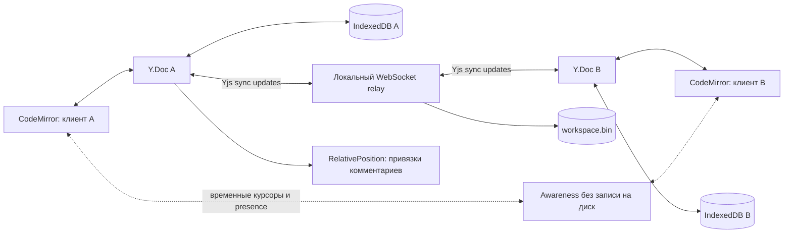

# Архитектура «На полях»

## Совместное состояние

Один Y.Doc комнаты содержит `documents: Y.Map<Y.Map>`. Документ: id, `title: Y.Text`, `body: Y.Text`, `comments: Y.Array<Y.Map>`, createdAt, archived. Комментарий: body, quote, author, relative start/end, resolved, `replies: Y.Array`. Локальные фильтры, выделенный документ и черновик комментария не отправляются как предметные данные.

Текст связывает CodeMirror 6 с Y.Text через **y-codemirror.next**, включая удалённые курсоры и undo собственных правок. Мы не пишем алгоритм CRDT и не выдаём работу Yjs за свою. Своя логика: модель документов и комментариев, относительные привязки, обработка удалённого контекста, интерфейс review, export/archive и relay/persistence boundary.

## Протокол

Клиент — y-websocket WebsocketProvider; сервер — небольшой Node `ws` relay, реализующий стандартные framing типы: sync=0, awareness=1, queryAwareness=3 через y-protocols и lib0. Initial state vectors → sync step 2; последующие Yjs updates рассылаются участникам. Максимум сообщения 8 МБ. Heartbeat закрывает пропавшие соединения. Presence — ephemeral awareness, удаляется при disconnect, не сохраняется на диск. BroadcastChannel отключён, поэтому multi-client демо действительно проверяет серверный канал.

Все экземпляры сервера локальные, только одна room `/workspace`. Горизонтального масштабирования и распределённой блокировки нет. `/health` показывает доступность процесса и количество соединений.

Транспорт использует механизмы установленного y-websocket: exponential reconnect backoff с максимумом 2500 мс и проверку отсутствия сообщений после 30 секунд (messageReconnectTimeout); relay дополнительно проверяет heartbeat раз в 25 секунд. Отдельная дублирующая обёртка таймаутов вокруг provider не добавляется. Значения проверены по исходникам установленной версии, а не измерены как SLA.

## Сохранение и offline

y-indexeddb восстанавливает локальный Y.Doc перед подключением provider. Параллельные изменения объединяет CRDT; никакой замены документа последним JSON-снимком. Relay загружает `workspace.bin`, хранит Y.Doc в памяти и сохраняет полный binary update через временный файл + rename. Записи сериализованы; debounce 80 мс уменьшает число дисковых операций. Graceful shutdown дожидается записи. Не утверждаем fsync-устойчивость или server-ack durability.

Production service worker сохраняет JS/CSS/preload shell и локальные шрифты. Build автоматически вычисляет hash ресурсов и исходника SW, создаёт полный precache manifest и meta версии HTML. В установленной оболочке navigation и файлы берутся из одного кэша; новая версия активируется целиком. Публичные статические ресурсы ищутся по path с `ignoreVary`, чтобы `Vary: Origin` не ломал module-запросы. Кэш оболочки и IndexedDB состояния независимы.

UI проверяет controller, cache presence и совпадение hash через MessageChannel, после чего показывает offline readiness. При ответе SW HTML получает диагностический meta `offline-shell-delivery`. Реальный browser offline reload не следует из успешного Node-теста модели SW.

## Якоря и обсуждения

Начало/конец — Y.RelativePosition, сериализованные в обычные JSON-объекты. Вычисление абсолютного диапазона происходит относительно текущего Y.Doc после любых обновлений. Полностью удалённый диапазон схлопывается: комментарий становится orphan, сохраняет исходную цитату и обсуждение. Частичное изменение продолжает принадлежать живому диапазону. Это осознанная семантика текстового review, а не обещание «находить смысл» после переписывания абзаца.

Ответы сразу используют один общий Y.Array, поэтому конкурентные ответы не заменяют друг друга. `resolved` и `archived` — значения Y.Map с детерминированным CRDT разрешением конкурентного изменения. Undo текста локален и не откатывает чужие правки. Экспорт JSON содержит результат и привязки, но не является импортируемым полным CRDT-backup; резервная копия комнаты — серверный binary snapshot.

## Границы

Нет вложений, rich text, пагинации Office, production identity, ACL и ограничения доступных документов внутри комнаты. IndexedDB требует доверенного браузера и свободного места. Tombstones CRDT и история обновлений могут расти; для больших многолетних комнат нужны retention/compaction policy и эксплуатационные метрики. Количество пользователей и задержка не заявлены без отдельного нагрузочного измерения.

## Что объяснить на интервью

1. **Почему Yjs вместо отправки всего текста по WebSocket?** Замена снимка последней стороной теряет конкурентные изменения. CRDT объединяет операции; интеграционный тест выполняет offline-правки двух клиентов и проверяет сходимость после reconnect.
2. **Что написано самостоятельно?** Предметная модель, review UX, семантика комментариев и orphan anchors, exports/archive, relay и границы persistence. Алгоритм CRDT, CodeMirror binding и клиентский протокол предоставлены библиотеками.
3. **Почему числовые offsets недостаточны для комментария?** Вставка перед фрагментом смещает координаты. RelativePosition опирается на структуру Yjs; при полном удалении диапазона комментарий остаётся без живого якоря, сохраняя исходную цитату.
4. **Зачем отделять awareness от документа?** Участие и курсоры временные и не должны сохраняться как история содержимого. Отключившийся участник удаляется из awareness; отображаемое имя не является аутентификацией.
5. **Что означает статус подключения?** Наличие sync-канала, а не fsync-подтверждение серверного диска. Локальный IndexedDB, серверный snapshot, канал связи и резервная копия — разные гарантии; JSON-экспорт не заменяет CRDT-backup.
