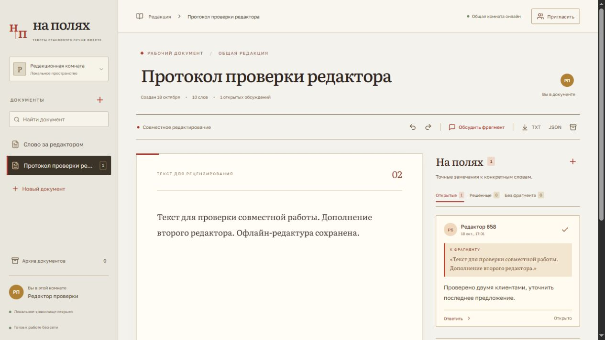

# На полях


Редакционная комната для совместной правки текста и обсуждения конкретных формулировок. Соавторы видят изменения и курсоры друг друга; комментарии привязаны к выделенным фрагментам и сохраняют историю обсуждения.

**Текст можно продолжать править без связи.** После подключения изменения объединяются через локальный WebSocket-сервер. Версия **0.1.0-rc.1**.

## Текст и обсуждение рядом

Проект рассчитан на редакторов, авторов и небольшие команды, которым нужно согласовать простой текст: инструкцию, описание продукта, письмо или рабочий документ.

- Несколько документов с названиями, поиском, архивом и восстановлением.
- Одновременное редактирование, настоящее присутствие участников и удалённые курсоры.
- Комментарии к выделению, ответы, отметка «решено» и повторное открытие обсуждения.
- Привязки перемещаются при вставках. После полного удаления фрагмента комментарий остаётся в истории с соответствующей отметкой.
- Локальные undo/redo для своих правок; экспорт текста в TXT и текста с обсуждениями в JSON.



Это снимок работающего редактора. Верхнее графическое превью представляет проект отдельно от интерфейса.

## Открыть комнату

Нужен **Node.js 22.12+**; проверено на Node.js 24 под Windows. Из корня репозитория:

```sh
npm ci
npm run build
npm start
```

Редактор: [127.0.0.1:4314](http://127.0.0.1:4314). Relay: `ws://127.0.0.1:4414/workspace`. `npm start` запускает оба процесса; Ctrl+C завершает их.

Для разработки используйте `npm run dev`. Раздельный запуск: `npm run api` для relay и `npm run preview` для готовой оболочки.

### Посмотреть совместную работу

1. Откройте редактор в двух браузерах или профилях на этом компьютере. Задайте разные имена в левой панели.
2. Создайте документ и откройте его в обоих клиентах. Внесите правки с двух сторон.
3. Выделите фрагмент и нажмите «Обсудить фрагмент». Добавьте комментарий, ответьте из второго клиента и отметьте обсуждение решённым.
4. Вставьте текст перед цитатой, затем удалите сам процитированный диапазон. Проверьте перемещение привязки и отметку удалённого контекста.

BroadcastChannel у provider отключён: обмен в этом демо проходит через настоящий relay, а не только между вкладками браузера.

### Продолжить без сервера

Дождитесь статуса **«Готов к работе без сети»**, остановите `npm start` и перезагрузите страницу. Измените текст и перезагрузите ещё раз: локальное состояние должно восстановиться.

Запустите только `npm run api`. Оболочка может оставаться в кэше при выключенном UI-сервере; после подключения relay изменения должны появиться у другого клиента. Такой сценарий проверен при приёмке.

Кэширование оболочки включено **только в production build**. Перед переключением на dev остановите preview. Если старый service worker продолжает открывать production-версию, выполните Unregister в DevTools → Application → Service Workers и удалите только Cache Storage. IndexedDB с документами сохраните.

## Как сохраняется работа

| Данные                                      | Где находятся                                     |
| ------------------------------------------- | ------------------------------------------------- |
| Текст, документы и обсуждения этого клиента | IndexedDB, `na-polyah-workspace-v1`               |
| Общее состояние комнаты                     | `data/workspace.bin` у relay                      |
| Имя участника и выбранный документ          | localStorage                                      |
| Курсоры и присутствие                       | Временное awareness-состояние, без записи на диск |

Сначала восстанавливается локальный Y.Doc, затем подключается сеть. Yjs объединяет конкурентные изменения; приложение не заменяет весь текст последним полученным JSON.

Relay сохраняет снимок через atomic rename с задержкой 80 мс. При аварийном завершении последние изменения могут ещё не попасть на серверный диск. Для обычной остановки используйте Ctrl+C и один relay на каталог данных.

Очистка браузера удалит неотправленную историю. TXT/JSON подходят для чтения и передачи результата, но JSON-экспорт не является полной резервной копией CRDT-комнаты. Для неё нужен сохранённый серверный `workspace.bin`.

## Стек и разделение ответственности

React 19 и TypeScript отвечают за библиотеку документов и review-интерфейс, CodeMirror 6 — за редактирование. Yjs, y-codemirror.next, y-websocket и y-indexeddb обеспечивают CRDT, привязку редактора, транспорт и локальное сохранение. Relay построен на Node.js, ws, y-protocols и lib0. Сборка — Vite; шрифты поставляются локально.

Собственная часть — модель документов и обсуждений, семантика потерянного якоря, экспорт и архив, интерфейс, relay и границы сохранения. CRDT-алгоритм и binding редактора предоставлены библиотеками. Схема и компромиссы — в [архитектуре](ARCHITECTURE.md).

## Границы комнаты

**Это одна доверенная комната на одном компьютере.** Участники видят и могут изменять все документы. Имя — отображаемая подпись, а не аутентификация; архив не ограничивает доступ.

По умолчанию relay слушает только loopback. Проверяются путь подключения и Origin браузера, но нет пользователей, ролей, tenant-изоляции, шифрования диска, аудита личности или автоматического backup. Не публикуйте relay и dev-сервер напрямую.

Область редактора — простой текст. DOCX, точное воспроизведение Office, вложения, rich text и работа с большими многолетними комнатами не заявлены. Индикатор «онлайн» показывает состояние канала, а не подтверждение fsync.

## Проверки

```sh
npm test
npm run build
npm run format:check
```

**5 автоматических сценариев прошли:** относительные якоря и удаление контекста; конкурентные offline-правки; реальный WebSocket sync и awareness двух клиентов с reconnect и рестартом; две проверки модели service worker.

В браузере подтверждены правки и комментарии двух клиентов через relay. При выключенных UI и relay полный reload восстановил документ; новая offline-правка пережила ещё один reload и после запуска только relay появилась у второго клиента.

Проверены autofocus, Escape и возврат фокуса в диалоге; дизайн просмотрен при 1265 и 390 px. Физические мобильные браузеры, установка PWA, IME, screen reader и удалённый CI отдельно не проверялись. Детали — в [приёмке](VERIFICATION.md).

## Разбор проекта

- [Архитектура, схема и вопросы для технического обсуждения](ARCHITECTURE.md)
- [Фактические результаты приёмки](VERIFICATION.md)
- [Изменения версии](RELEASE_NOTES.md)
- [Дизайн: источники и собственная реализация](DESIGN_PROVENANCE.md)

Лицензия собственных исходников пока не объявлена. Лицензии зависимостей сохраняются в пакетах; оригиналы лицензий Golos Text и Literata находятся в [public/licenses](public/licenses).
